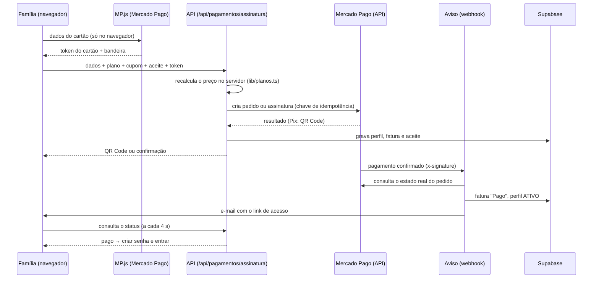

# Arquitetura — Nutrindo em Casa

Documento vivo: descreve **como a aplicação está construída hoje**, as decisões técnicas e o que mudou em relação à proposta inicial (`docs/proposta.md`).

## 1. Visão geral

Plataforma web de acompanhamento nutricional infantil: a família faz a assinatura, preenche a anamnese, registra o diário alimentar, agenda a consulta, conversa com a nutricionista e assiste às aulas. A nutricionista usa um painel próprio.

## 2. Tecnologias

| Camada | Tecnologia | Para quê |
|---|---|---|
| Interface | React 19, Next.js 16 (App Router), TypeScript, Tailwind CSS 4 | Páginas, estado e estilo |
| Servidor | Rotas de API do Next.js (Node.js) | Endpoints REST em `src/app/api` |
| Banco e login | Supabase (PostgreSQL + Auth) | Dados e identidade (JWT) |
| Pagamentos | Mercado Pago (Orders API, Assinaturas e MP.js) | Pix, cartão (à vista por assinatura recorrente; parcelado na primeira compra) e estorno |
| E-mail | Resend | Boas-vindas e avisos de renovação |
| Agenda | Google Calendar API | Eventos, sala do Meet e horários ocupados |
| Hospedagem | Vercel | Deploy a cada push em `main` e cron diário |
| Testes | `node:test` (Node.js) | Regras puras de validação, cálculo, pedidos ao Mercado Pago e renovação (`tests/`) |

## 3. Organização do código

```
src/
├── app/                    # Páginas (App Router) e rotas de API
│   ├── api/                # Endpoints REST (um route.ts por recurso)
│   ├── anamnese/           # Formulário clínico em 8 etapas (+ validation.ts)
│   ├── dashboard/          # Área da família: diário, calendário, chat, cursos...
│   ├── nutri/              # Painel e prontuários da nutricionista
│   ├── pagamento/          # Checkout (Pix e cartão)
│   └── login, termos, privacidade, criar-senha, ...
├── components/             # Componentes compartilhados (TermosGate, Sidebar, ...)
├── hooks/useAuthGuard.ts   # Proteção de páginas e encerramento de sessão
└── lib/                    # Regras de negócio e integrações (sem tela)
    ├── auth.ts             # Valida o token no servidor, papel (nutri/cliente)
    ├── planos.ts           # Fonte única de preços (Pix e cartão) e parcelas
    ├── cupons.ts, assinatura.ts          # Cupons e situação do acesso
    ├── mercadopago.ts, mpPedidos.ts, mpPayloads.ts   # Mercado Pago: API, pedidos e regras puras
    ├── pagamentosWebhook.ts, pagamentosEstado.ts     # Avisos do Mercado Pago (webhook)
    ├── renovacaoLink.ts, renovacaoRegras.ts          # Renovação por link e avisos por e-mail
    ├── googleAgenda.ts, agendaSync.ts   # Integração com a agenda
    ├── email.ts, termos.ts, tokenCompra.ts, rateLimit.ts
supabase/
├── schema.sql              # Esquema inicial
└── migrations/             # Alterações aplicadas em ordem (SQL)
tests/                      # Testes automatizados
docs/                       # Documentação e evidências de cada etapa
```

**Camadas.** (1) *Interface* (`app/**/page.tsx`) → (2) *Rotas de API* (`app/api/**/route.ts`: autenticam, validam a entrada e respondem JSON) → (3) *Regras e integrações* (`lib/`) → (4) *Banco* (Supabase). As regras que não dependem de tela ficam em `lib/` para poderem ser reaproveitadas e testadas.

## 4. Autenticação e autorização

1. `POST /api/auth/login` valida e-mail/senha (ou CPF) no Supabase Auth e devolve `token` e `refresh_token`.
2. O navegador guarda o token e um interceptador (`authFetch`) coloca `Authorization: Bearer …` em toda chamada a `/api/*`, renovando a sessão uma vez se receber 401.
3. **Toda rota protegida valida o token no servidor** (`lib/auth.ts` → `exigirUsuario` / `exigirNutri`). Nada vem do navegador sem conferência: o e-mail-alvo e o papel são derivados do token.
4. O papel de nutricionista vem de `app_metadata.role` (gravável só pelo servidor), nunca de dados editáveis pelo usuário.
5. O banco só é acessado pelo servidor com a chave de serviço; os papéis públicos do Supabase (`anon`/`authenticated`) não têm acesso às tabelas.
6. `POST /api/auth/logout` revoga a sessão no servidor; o front apaga os dados locais.
7. Tentativas de login com falha têm limite por IP (40) e por conta (8) em uma janela de tempo (`lib/rateLimit.ts`).

## 5. Modelo de dados (PostgreSQL)

| Tabela | Conteúdo |
|---|---|
| `profiles` | Responsável: dados, plano, status da assinatura, renovação, aceite dos termos |
| `anamneses` | Respostas da anamnese (JSON) e se foi concluída |
| `agendamentos` | Consultas e metas (data, horário, link do Meet, id do evento no Google) |
| `diario_refeicoes` | Alimentos oferecidos, refeição, degrau da escada, observações, foto |
| `mensagens_chat` | Conversa família ↔ nutricionista (com anexos) |
| `devolutivas_semanais`, `prescricoes_plano`, `respostas_rapidas_nutri` | Material clínico da nutricionista |
| `curso_estrutura`, `materiais_aulas` | Módulos, aulas e materiais |
| `faturas` | Cobranças (Pix, cartão, parcelas) |
| `cupons` | Código, percentual (1–99%), validade e limite de uso |
| `gateway_eventos` | Avisos do provedor de pagamento já processados (evita duplicidade) |
| `aceites_termos` | Trilha de auditoria do aceite (versão, data, IP, navegador) |
| `google_integracao` | Conexão com o Google da nutricionista (token só no servidor) |

As alterações do esquema estão em `supabase/migrations/` (aplicadas em ordem).

## 6. Endpoints da API

| Grupo | Endpoints | Quem acessa |
|---|---|---|
| Conta | `POST /api/auth/login`, `/refresh`, `/logout`, `/forgot-password`, `/update-password`, `/criar-senha-compra`; `GET /api/auth/me`, `/google`, `/google/callback` | Público ou logado |
| Cliente | `GET·POST /api/anamnese`, `/diario`, `/agendamentos`, `/chat`; `GET·PUT /api/configuracoes`; `GET·POST /api/termos`; `GET·PATCH /api/devolutivas`; `GET /api/cursos` | Cliente (só os próprios dados; a nutricionista também acessa) |
| Nutricionista | `GET·POST /api/nutri`; `GET·POST·DELETE /api/nutri/google`; `POST /api/cursos`; `POST·PATCH·DELETE /api/cupons` | Nutricionista |
| Pagamento | `POST /api/pagamentos/assinatura`, `/cancelar`; `GET /api/pagamentos/status`; `GET /api/cupons?codigo=` (validar cupom) | Público (checkout) ou logado |
| Integrações | `GET /api/cron/renovacoes` (segredo); `GET·POST /api/google-calendar/events`; `POST /api/pagamentos/webhook` (aviso do Mercado Pago, com assinatura `x-signature`) | Sistemas externos |

## 7. Fluxos principais

### 7.1 Compra com Pix ou cartão

Três modelos de cobrança, escolhidos no servidor conforme a forma de pagamento:

| Forma | Como é cobrado | Renovação |
|---|---|---|
| Pix | Pedido (Orders API) à vista, com QR Code e "copia e cola" | Link de Pix enviado por e-mail 7 dias antes do vencimento |
| Cartão à vista | **Assinatura** do Mercado Pago (cobra na hora e a cada ciclo) | Automática, pelo Mercado Pago; aviso por e-mail 7 dias antes |
| Cartão parcelado (primeira compra) | Pedido (Orders API) em N parcelas; os juros (se houver) vêm da tabela do Mercado Pago e o cliente vê o total exato antes de pagar | Link de Pix por e-mail, como no Pix |



Preços: cada plano tem dois valores, definidos em `lib/planos.ts` e lidos pelo servidor e pelas telas. O **Pix** é mais barato (R$ 197 / R$ 531,90 / R$ 2.009,40), como incentivo, e o **cartão** é o preço padrão (R$ 210 / R$ 567,00 / R$ 2.142,00), na mesma proporção, mantendo os descontos de 10% (trimestral) e 15% (anual). O servidor escolhe o preço pela forma de pagamento; a assinatura no cartão renova pelo preço do cartão e o Pix de renovação, pelo do Pix.

Parcelamento: quem paga os juros é configuração da conta do Mercado Pago (a Orders API não permite escolher por pedido). A tela mostra as parcelas reais do cartão digitado (`getInstallments` do MP.js), com juros e total. O servidor confere a tabela do Mercado Pago antes de cobrar e, depois, o total pago: se divergir do que foi mostrado, não cobra ou estorna na hora.

Proteções contra erro e cobrança em dobro: uma **trava de 1 minuto** por e-mail e plano impede dois pagamentos de cartão simultâneos (clique duplo, duas abas); se algo falhar depois da cobrança (ex.: o banco de dados), o pedido é **estornado automaticamente** (com nova tentativa, pois o Mercado Pago recusa estornos feitos nos primeiros segundos); ao reassinar ou fazer upgrade, a assinatura antiga é cancelada no Mercado Pago.

Pontos de segurança: o número do cartão e o CVV **nunca chegam ao servidor** (só o token gerado no navegador); o valor é sempre recalculado no servidor, incluindo cupom e crédito de upgrade; o cupom e o pedido são desfeitos se qualquer etapa falhar; o cupom vale só para a primeira cobrança (a assinatura é ajustada para o preço de tabela logo depois).

### 7.2 Renovação, cancelamento e avisos do Mercado Pago
O Vercel chama `GET /api/cron/renovacoes` todo dia às 12:00 UTC (a rota exige o segredo do cron):

- **Pix e parcelado:** 7 dias antes do vencimento a rotina cria um Pix de renovação (preço de tabela, validade de 12 dias) e envia o link por e-mail, uma única vez por ciclo. Quando o Pix é pago, o aviso do Mercado Pago avança o ciclo. Nada é cobrado sem a ação da pessoa.
- **Cartão à vista:** o Mercado Pago cobra sozinho; a rotina só envia o aviso de 7 dias antes.
- **Conferência diária (rede de segurança):** a rotina consulta no Mercado Pago as assinaturas de cartão que venceram, cria a fatura de cada cobrança que ainda não existir e corrige a data da próxima renovação. Assim, um aviso perdido não bloqueia o cliente por engano nem deixa a fatura sem aparecer.
- **Atraso:** além de 5 dias de carência o cadastro passa a INADIMPLENTE (o acesso já é bloqueado em tempo real por `statusEfetivo`).
- **Cancelamento** (`POST /api/pagamentos/cancelar`): cancela a assinatura **no Mercado Pago primeiro**; se não conseguir, nada muda no site. O acesso continua até o fim do período já pago e um Pix de renovação em aberto também é cancelado.
- **Estornos:** estorno total (ou contestação) de qualquer cobrança muda a fatura para "Estornado", o acesso para CANCELADO e cancela a assinatura no Mercado Pago; estorno parcial mantém o acesso. O estorno é feito no painel do Mercado Pago (Atividade > Devolver dinheiro) e o site se ajusta sozinho pelo aviso.
- **Aviso (webhook):** `/api/pagamentos/webhook` valida a assinatura `x-signature` (HMAC-SHA256, janela de 5 minutos), consulta o Mercado Pago para saber o estado real, registra o aviso em `gateway_eventos` (sem processar duas vezes) e atualiza fatura e perfil. Um aviso atrasado nunca desfaz uma fatura paga. Cobrança recusada de renovação conta falhas (3 falhas = INADIMPLENTE, com e-mail).

### 7.3 Agendamento sincronizado com a agenda da nutricionista
A nutricionista conecta o Google no painel. Ao marcar uma consulta, a API cria o evento com a sala do Meet e o convite para a família, e os horários que ela já tem ocupados deixam de ser oferecidos. Um índice único no banco impede duas famílias no mesmo horário.

## 8. Decisões técnicas

| Decisão | Motivo | Alternativa descartada |
|---|---|---|
| **Next.js com rotas de API** no mesmo projeto | Um único deploy, tipos compartilhados entre tela e servidor | Servidor Express separado |
| **Supabase** (Postgres + Auth) | Login, banco e e-mail de convite prontos; plano gratuito | Prisma + PostgreSQL próprio (previsto na proposta) |
| **Acesso ao banco só pelo servidor** | Evita regras de acesso no navegador e vazamento de dados de saúde | Consultas diretas do navegador com RLS |
| **Preço sempre calculado no servidor** (`lib/planos.ts`) | O navegador nunca define quanto será cobrado | Enviar o valor do front |
| **Mercado Pago** como provedor de pagamento | Pix, cartão e assinatura recorrente; estorno sem perda da taxa a confirmar na prática | Asaas (usado nos testes e removido), Hotmart (previsto na proposta) |
| **Aviso de pagamento idempotente** (`gateway_eventos`) | Avisos podem chegar repetidos ou fora de ordem | Processar cada aviso sem registro |
| **Token JWT validado no servidor** | Sessão revogável e papéis confiáveis | Sessão por cookie (previsto na proposta) |
| **Token do cartão gerado no navegador** (MP.js) | Número e CVV nunca passam pelo nosso servidor nem ficam guardados | Enviar os dados do cartão ao servidor |
| **Regras puras em `lib/` e `validation.ts`** | Podem ser testadas sem tela nem banco | Regras dentro dos componentes |
| **Termos com versão e aceite auditável** | Prova de consentimento (dados de saúde de crianças) | Aceite só no cadastro |

## 9. Mudanças em relação à proposta inicial

| Proposta | Hoje | Por quê |
|---|---|---|
| Prisma + PostgreSQL | Supabase (`supabase-js`) com migrações SQL | Menos infraestrutura; login e banco no mesmo serviço |
| Hotmart (webhook cria o usuário) | Checkout próprio com Mercado Pago | Controle do fluxo, Pix e parcelamento |
| Sessão por cookies | JWT (Bearer) validado no servidor | Revogação de sessão e rotas de API simples |
| Dados simulados | Dados reais com persistência | Evolução do projeto |

## 10. Limitações e evolução

- O limitador de tentativas fica na memória de cada instância do servidor (suficiente hoje; para escala, usar um armazenamento compartilhado).
- O ambiente local usa o mesmo banco de produção; o ideal é ter um projeto Supabase só para desenvolvimento e testes.
- Há testes automatizados só para as regras puras. Faltam testes das rotas de API (contrato de entrada e saída).
- Padronizar as respostas de erro das rotas e publicar o contrato da API (OpenAPI/Postman) facilitará testes e novos clientes.
